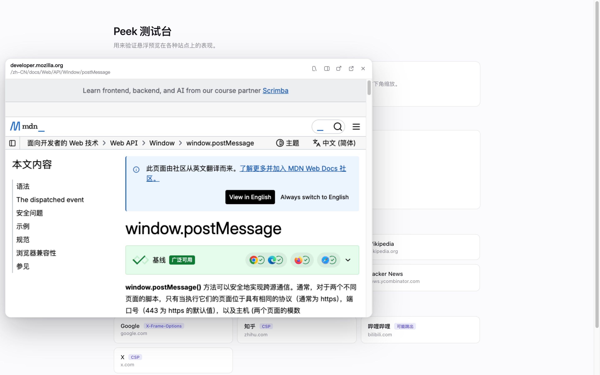
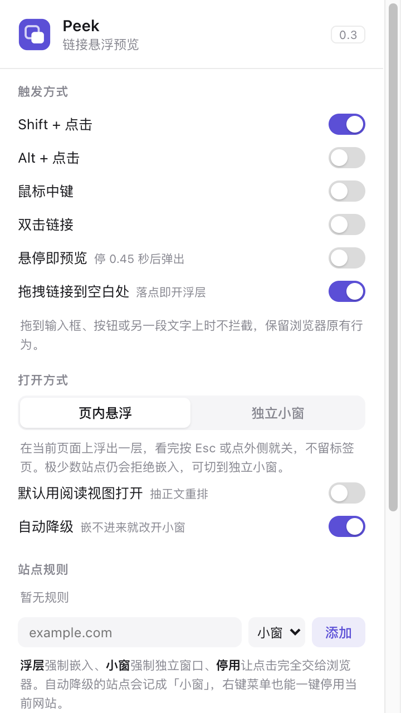
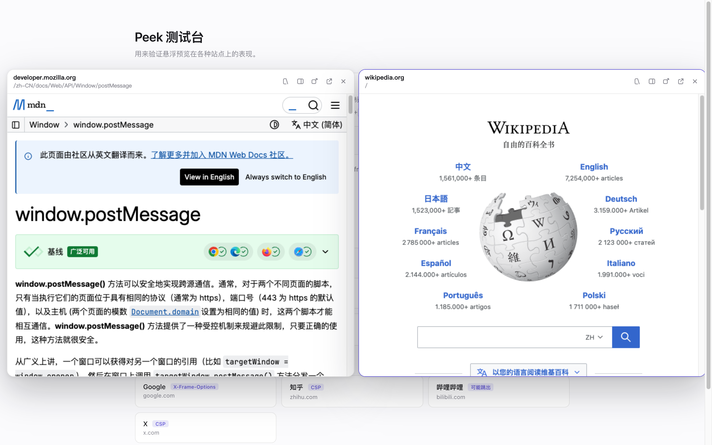
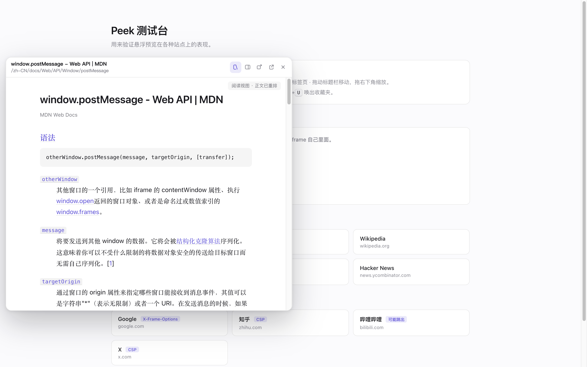

# Peek

**按住 <kbd>Shift</kbd> 点链接，目标页面就在当前页浮起来。**

Arc Peek 的 Chrome 开源复刻，并往前多走了五步：多个浮层并排对照、抽正文重排的阅读视图、嵌不进来时自动改走独立小窗的按站点路由、iframe 里的链接也能拦，以及一个可收藏稍后读的链接列表。

[](LICENSE)
[](manifest.json)
[](https://www.google.com/chrome/)
[](#开发与调试)

[English](#english) · [安装](#安装) · [使用](#使用) · [实现要点](#五个实现要点) · [路线图](#路线图) · [贡献](#贡献)



Peek 是一个 Manifest V3 扩展，没有构建步骤、没有运行时依赖、没有账号和遥测。克隆下来就能在 `chrome://extensions` 里加载。

## 功能

- **页内浮层**：看完按 <kbd>Esc</kbd> 或点浮层外侧关掉，不留标签页。
- **多浮层并排**：开着浮层时再 <kbd>Shift</kbd> + 点一个链接，自动左右并排。默认最多 3 个，可设 2–4 个。
- **阅读视图**：本地运行 Mozilla Readability 抽出正文重排，去掉导航、侧栏和广告。
- **四种去向**：页内浮层、右侧停靠（≈ Split View）、独立小窗（≈ Little Arc）、正式标签页。
- **按站点路由**：登录 / 授权页直接走小窗；浮层 6 秒没加载完自动降级并记住该站点；也可以逐站强制浮层、小窗或彻底停用。
- **iframe 里也能拦**：`all_frames: true`，Google Docs、Notion 嵌入块、Bilibili 和各种广告 iframe 里的链接一样能预览。
- **拖拽触发**：把链接拖到页面空白处，落点即开浮层。
- **收藏夹**：<kbd>Ctrl</kbd>/<kbd>⌘</kbd> + 右键收藏，<kbd>Alt</kbd> + <kbd>U</kbd> 唤出，可一键导出 Markdown。
- **零遥测**：没有埋点、没有远程请求、没有账号。

## 安装

### 从源码加载

```bash
git clone https://github.com/Oneideals/peek-preview.git
```

1. 打开 `chrome://extensions`
2. 右上角打开「开发者模式」
3. 点「加载已解压的扩展程序」，选择克隆下来的 `peek-preview/` 目录
4. 钉到工具栏，点一下可改设置

Edge / Brave / 其他 Chromium 浏览器同理：

| 浏览器 | 扩展管理页 |
| --- | --- |
| Chrome | `chrome://extensions` |
| Edge | `edge://extensions` |
| Brave | `brave://extensions` |

要求 Chrome 116 及以上：阅读视图依赖 `chrome.offscreen`。扩展没有商店版本，更新时在扩展卡片上点刷新，再刷新目标网页即可。

<p align="center">
  
</p>

## 使用

| 操作 | 结果 |
| --- | --- |
| <kbd>Shift</kbd> + 点击链接 | 悬浮预览（默认唯一触发方式，其余在设置里开） |
| <kbd>Alt</kbd> + 点击 / 中键 / 双击 / 悬停 | 可选触发方式 |
| **把链接拖到页面空白处** | 落点即开浮层；拖的时候有「松开预览 xxx」的提示 |
| 已开着浮层时再 <kbd>Shift</kbd> + 点别的链接 | **再开一个，自动左右并排**（默认最多 3 个，可设 2–4 个） |
| <kbd>Esc</kbd> | 关掉当前有紫色边框（焦点）的那一个 |
| 点浮层外面 | 单个浮层：关掉它；多个浮层：全部收起；停靠状态下不关 |
| 拖标题栏 | 移动浮层 |
| 拖右下角 / 右边 / 下边 | 缩放，尺寸会记住 |
| 顶部「阅读」按钮 | 抽出正文重排，去掉导航侧栏广告；再点一次回到原页面 |
| 顶部「停靠」按钮 | 吸附到右侧半屏，此时主页面仍可操作（≈ Arc 的 Split View） |
| 顶部「小窗」按钮 | 转成独立小窗（≈ Arc 的 Little Arc） |
| 顶部「新标签」按钮 | 落到正式标签页，浮层关闭 |
| <kbd>Ctrl</kbd> / <kbd>⌘</kbd> + 右键点链接 | **收藏这个链接** |
| <kbd>Alt</kbd> + <kbd>U</kbd> | 唤出收藏列表面板 |
| 右键链接 | 「用 Peek 悬浮预览」／「在独立小窗中打开」 |
| 右键页面空白处 | 「查看收藏的链接」／「在此网站停用 Peek」 |
| 兜底面板上「始终用窗口」 | 这个站点以后都用独立小窗打开 |

浮层里的链接可以直接继续点，导航发生在浮层里，不会污染你的页面 —— 这是用真 iframe 换来的好处。阅读视图里的正文链接也一样，点了会再开一个浮层并排。

**iframe 里的链接也拦。** `all_frames: true`，所以 Google Docs、Notion 嵌入块、Bilibili、各种广告 iframe 里的链接一样能预览 —— 浮层开在那个 iframe 自己里面，尺寸跟着 iframe 的视口走。

**拖拽是安全的。** 拖到输入框、按钮、另一段文字、或标记了 `data-peek-ignore` 的容器上时完全不干预，浏览器原有行为照旧；站点自己的拖放面板大多落在具体容器上，这条检查能挡掉大部分。

## 界面

<p align="center">
  
  
</p>

左：两个浮层自动等宽并排，各有独立的标题栏与导航。右：阅读视图会重新抓取网页、抽出正文重排，所以对拒绝嵌入的站点同样有效。

## 和 Arc 的对应关系

| Arc | 本扩展 |
| --- | --- |
| Peek（页内预览层） | <kbd>Shift</kbd> + 点击 |
| 点外侧关闭 / <kbd>Cmd</kbd>+<kbd>W</kbd> | 点外侧 / <kbd>Esc</kbd> |
| 展开为新标签页 | 顶部「新标签」 |
| Split View | 顶部「停靠」 |
| Little Arc（独立小窗） | 顶部「小窗」／右键菜单 |
| ——（Arc 没有） | **多浮层并排对照** + **阅读视图** |

差别在于：Arc 是浏览器自己画的图层，扩展只能在网页图层里画。绝大多数场景没区别，遇到页面里 `<dialog>`、全屏元素这类跑在 top-layer 的东西时，可能被压住。

更本质的一层：**这个功能做不到 100% 复刻 Arc**。视觉、交互、并排、停靠这些能复刻到约 95%；但页内浮层是跨站 iframe，Arc 的 Peek 是浏览器自己持有的第二块渲染表面 —— 那意味着登录态、OAuth 跳转、<kbd>Cmd</kbd>+<kbd>F</kbd> 页内查找、DevTools 独立入口、权限提示这些，扩展拿不到。所以才有下面的按站点路由：能嵌的走浮层，嵌不了的、要登录的走小窗。

## 按站点路由：嵌不进来就自动改走小窗

页内浮层是 Arc 的手感，但它是**跨站 iframe**，而独立小窗是**第一方上下文** —— 后者才有登录态、OAuth 跳转和页内查找。所以扩展会自动判断该走哪条：

| 优先级 | 判断 | 行为 |
| --- | --- | --- |
| 1 | 站点被记住的规则（设置里可删） | 按规则走 |
| 2 | 全局设置「始终用独立小窗」 | 走小窗 |
| 3 | URL 命中登录 / 授权启发式 | 直接走小窗，弹提示 |
| 4 | 以上都不中 | 走页内浮层 |
| 5 | 浮层 6 秒没加载完（`LOAD_TIMEOUT`） | 自动降级：关浮层、开小窗、**记住这个站点** |

站点规则有三种取值，设置面板「站点规则」区逐站可选：

| 规则 | 含义 |
| --- | --- |
| `iframe` | 这个站点一律走页内浮层（连启发式都不启用） |
| `window` | 这个站点一律走独立小窗 |
| `off` | **彻底停用 Peek** —— 这个站点的点击完全交给浏览器，Shift、拖拽、右键全部不拦 |

「停用」是最基本的逃生门：某个网站的链接被你自己的快捷键习惯误伤时，用它一键闭嘴。右键菜单里也有「在此网站停用 Peek」。

命中登录 / 授权的启发式：`accounts.*` / `login.*` / `sso.*` / `auth.*` / `cas.*` 等子域，Google / Microsoft / Apple 的登录域，Okta、Auth0、OneLogin 等身份提供方，以及路径里的 `/login` `/signin` `/oauth` `/authorize` `/saml` `/sso` `/cas` `/session/new` 等。

规则记在 `chrome.storage.local` 的 `siteRules` 里。

> 这里**没有**做「探测浮层是否被拒」：实测确认，跨站 iframe 无论加载成功还是被 `X-Frame-Options` 拒绝，content script 读到的都是 `SecurityError`，完全无法区分；网络层虽然有 `ERR_BLOCKED_BY_RESPONSE` 能报出来，但要拿到它必须加 `webRequest` 权限（会弹出「读取您的浏览记录」警告），而 DNR 已经把 XFO/CSP 摘掉，真实收益接近零，不值得。所以走的是「补全响应头 + 超时降级」这条零权限路线。

## 五个实现要点

**1. 怎么保证「任何站点都能打开」**

iframe 被拒只有三个原因：`X-Frame-Options`、CSP 的 `frame-ancestors`、以及 `Cross-Origin-Resource-Policy`。所以扩展用 `declarativeNetRequest` 的**会话级规则**，在打开预览的瞬间给**当前这一个 tab** 移除这三个响应头，且只作用于 `sub_frame`：

```js
{
  id: tabId,                       // 一个 tab 一条规则
  action: { type: 'modifyHeaders', responseHeaders: [
    { header: 'x-frame-options', operation: 'remove' },
    { header: 'content-security-policy', operation: 'remove' },
    { header: 'cross-origin-resource-policy', operation: 'remove' }
  ]},
  condition: { tabIds: [tabId], resourceTypes: ['sub_frame'] }
}
```

关掉浮层 1.5 秒后自动移除，标签页关闭时兜底清理。**不是全局放行**，是精确到 tab 的临时许可。

**2. 怎么保证不被网站样式污染**

整块 UI 挂在 Shadow DOM 里，样式用 `CSSStyleSheet` + `adoptedStyleSheets` 注入（构造式样式表不受页面 `style-src` CSP 限制），外层 `:host` 加 `all: initial`，宿主的定位再用内联 `!important` 钉死。站点写 `div { display: flex !important }` 也打不进来。

**3. 怎么防止网站「跳出 frame」**

iframe 带 `sandbox`，但**不给** `allow-top-navigation`。站点执行 `top.location = self.location` 时会直接抛错，你的页面不会被顶掉。

**4. 遮罩为什么不吃事件**

早期版本用一层全屏遮罩做「点外侧关闭」，副作用是右键菜单被吃掉、也没法在浮层打开时再点第二个链接。现在遮罩只负责变暗（`pointer-events: none`），关闭逻辑挪到文档级 `pointerdown`：

- 命中带修饰键的链接 → 放行，交给 `openPeek` 开第二个浮层
- 有任何浮层停靠 → 不关（那是分屏模式）
- 单个浮层 → 关它；多个 → 全部收起

多个浮层同时存在时会自动重排成等宽并排（`tile()`），停靠的那个不参与排列。

**5. 阅读视图与收藏夹**

阅读视图用 `chrome.offscreen` 起一个隐藏页面（MV3 的 service worker 没有 `DOMParser`），在里面 `fetch` 原网页 → `DOMParser` 解析 → Mozilla Readability 抽正文 → 剥掉脚本、表单、`on*` 属性和 `javascript:` 链接 → 产出 HTML 交给 `iframe.srcdoc`。因为是重新抓取而不是读 iframe 内容，它对**拒绝嵌入的站点同样有效**。

收藏夹存 `chrome.storage.local.favorites`（上限 400 条，超出截断）。键盘用 `e.code === 'KeyU'` 而不是 `e.key`：macOS 上按住 Option 会把 `u` 变成死键，`e.key` 会返回 `"Dead"`，绑定必失效。收藏的标题来自网页文本，所以渲染时**一律走 `textContent`**，不当 HTML 拼接 —— 否则存一个 `` 进去就是自建 XSS。

## 隐私与权限

| 权限 | 用途 |
| --- | --- |
| `storage` | 存设置、窗口尺寸、站点规则和收藏夹 |
| `declarativeNetRequest` + `<all_urls>` | 按 tab 临时放行 iframe 响应头、阅读视图抓网页 |
| `contextMenus` | 右键菜单 |
| `offscreen` | 跑 Readability（需要 DOMParser） |
| `favicon` | 浮层标题栏的站点图标（本地读取，不走第三方） |

没有埋点、没有远程请求、没有账号。阅读视图虽然会重新请求目标网页，但那是你自己要去的地方。收藏夹只存在本地，不同步、不上传。

## 已知限制

- **CSP 放行是双刃的**：预览期间（最多到浮层关闭后 1.5 秒），该 tab 内所有子框架的 CSP 都会被摘掉。别在开着预览的同一个 tab 里做支付、登录这类敏感操作。
- **阅读视图是重新抓取一遍网页**，所以：
  - 需要登录才能看的内容很可能抓不到（带 cookies 请求，但第三方 cookie 规则常挡下）
  - SPA、靠 JS 渲染正文的页面可能抽空
  - 视频、评论这类交互元素会消失（这是阅读视图的本意）
  - 抽不出来时会明确报错，并给「切回原页面」的出口
- 少数站点即使放开响应头也打不开：检测到 sandbox 后主动报错。这时走「小窗」或「阅读视图」。
- **页内浮层是跨站上下文，登录态可能掉**：`SameSite=Lax` 的会话 cookie 在 iframe 里不发，Chrome 的 storage partitioning 也会把 localStorage 按顶层站点隔开。所以从 A 站 peek 到知乎、GitHub、Notion、Gmail，很可能显示成未登录 —— 这是 Arc 不会有、扩展结构上绕不开的（Arc 的 Peek 是顶层导航语义）。要么点「小窗」，要么把站点加进规则。
- **自动降级是启发式，会误判**：`/auth`、`/login` 这类路径也可能出现在正常文档站上。误判了就进设置「站点规则」把它删掉，或者干脆把站点设成「停用」。
- 站点规则是**精确匹配主机名**（`example.com` 不含 `a.example.com`）。
- **拖拽触发是启发式**：只接「拖到页面空白处」。如果一个网站把自己的拖放面板做成了一个大 div，拖链接上去仍可能被 Peek 接走。真遇到了就把那个站点设成「停用」，或者关掉设置里的「拖拽链接到空白处」。
- 收藏夹存在本地 `chrome.storage.local`，不联网、不同步，上限 400 条。
- Chrome 不允许扩展创建完全无地址栏的窗口（需要 `panel` 类型，仅 ChromeOS 支持），所以「独立小窗」仍有一条地址栏，只是没有标签栏。
- 全屏浏览时，页面里的固定定位元素可能不显示（浏览器行为，非本扩展问题）。
- 只在 `http/https` 页面生效；`chrome://`、扩展商店页面是浏览器禁止注入的。

## 开发与调试

没有构建步骤。改完 JS 后：

1. 打开 `chrome://extensions` → 找到 Peek → 点刷新
2. 刷新目标网页

重新生成图标（纯标准库，无依赖）：

```bash
python3 scripts/make_icons.py
```

调 demo 页面的两种方式：

```bash
# 方式一：本地起个服务（推荐，免权限）
cd peek-preview && python3 -m http.server 8080
# 打开 http://localhost:8080/demo/

# 方式二：直接双击 demo/index.html
# 但要在 chrome://extensions 里给 Peek 打开「允许访问文件网址」
```

目录：

```
peek-preview/
├── manifest.json          MV3 清单（all_frames: true）
├── background.js          会话规则 / 右键菜单 / 小窗 / offscreen 调度
├── content/peek.js        拦截 + 浮层 + 并排 + 阅读视图 + 按站点路由 + 拖拽 + 收藏夹
├── offscreen.html         Readability 运行载体（隐藏）
├── offscreen.js           抓网页 → 抽正文 → 消毒 → 产出 HTML
├── lib/Readability.min.js Mozilla Readability 0.5.0（Apache-2.0，本地内置）
├── popup/                 设置面板
├── icons/                 16/32/48/128
├── demo/                  测试台
├── docs/screenshots/      README 截图
├── scripts/make_icons.py  图标生成
├── LICENSE
└── THIRD_PARTY_NOTICES.md
```

## 路线图

- [ ] 划词搜索 / 翻译（直接在选择上拖出小窗）
- [ ] 按站点记住窗口尺寸，而不是全局一个尺寸
- [ ] 站点规则支持通配符 / 子域匹配，以及「这个站点例外」的一键反悔
- [ ] 收藏夹支持分组 / 标签，以及导入
- [ ] 阅读视图里保留代码块 / 表格的更好排版，以及脚注还原
- [ ] 把浮层内容喂给 AI：把当前预览的网页内容直接发给大模型提问
- [ ] 多浮层时支持位置交换，以及 <kbd>Tab</kbd> 键在浮层之间跳转

## 贡献

欢迎 Issue 和 PR。这个项目刻意保持「无构建、无依赖、单文件内容脚本」的形态，提交时请尽量遵守：

- 在 `demo/` 测试台跑一遍 Shift 点击、并排、停靠、阅读视图、小窗和收藏夹
- 不引入构建步骤和运行时依赖；需要第三方库时本地内置并补充授权说明
- 改动 UI 时同步更新 README 截图（截图放在 `docs/screenshots/`）

## 许可证

[MIT](LICENSE) © 2026 Jerry Cheng

内置的 [Mozilla Readability](https://github.com/mozilla/readability) 0.5.0 使用 Apache-2.0，授权全文见 [`lib/Readability.LICENSE`](lib/Readability.LICENSE)，说明见 [THIRD_PARTY_NOTICES.md](THIRD_PARTY_NOTICES.md)。

本项目是社区作品，与 The Browser Company 及 Arc 浏览器无关联，也未获其背书。Arc 是其各自权利人的商标。

## English

**Peek** is an open-source Chrome extension that brings Arc's link preview to Chromium browsers. Hold <kbd>Shift</kbd> and click any link to open it in a floating layer above the current page. Press <kbd>Esc</kbd> or click outside to dismiss — no tab left behind.

Highlights:

- Multiple peeks tiled side by side (default 3, configurable 2–4)
- Reading view powered by Mozilla Readability, running locally in an offscreen document
- Dock to the right (Split View), open in a small standalone window (Little Arc), or promote to a tab
- Per-site routing: auth pages go straight to a window; sites that refuse embedding fall back after 6 seconds and are remembered
- Works inside iframes (`all_frames: true`)
- Drag a link onto empty page space to peek at the drop point
- Local favorites (<kbd>Ctrl</kbd>/<kbd>⌘</kbd> + right-click, <kbd>Alt</kbd> + <kbd>U</kbd>), exportable as Markdown
- No build step, no runtime dependencies, no telemetry, no account

Install: clone this repo, open `chrome://extensions`, enable Developer mode, and load the unpacked `peek-preview/` directory. Chrome 116+ is required.

License: [MIT](LICENSE). Vendored Mozilla Readability is Apache-2.0; see [THIRD_PARTY_NOTICES.md](THIRD_PARTY_NOTICES.md).

> Peek is a community project and is not affiliated with, or endorsed by, The Browser Company or Arc.
